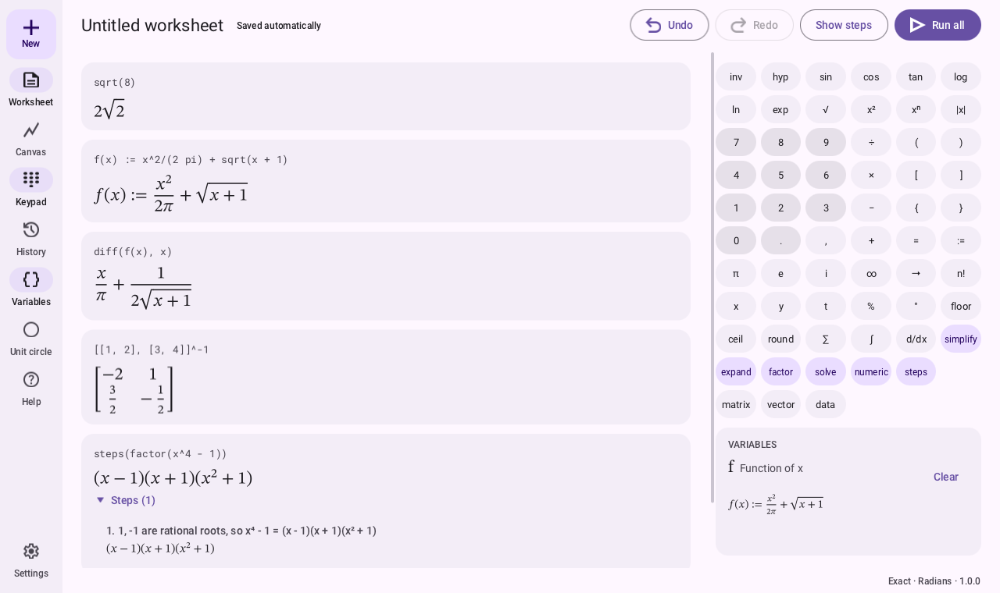
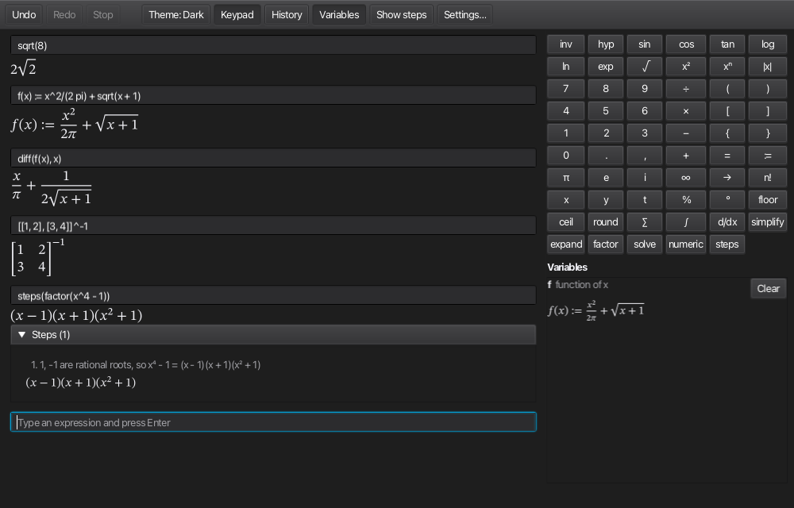

# math-canvas

A desktop app for doing maths: type an expression in a worksheet and get an exact answer, with
the steps that led to it, and draw graphs and geometric figures on a canvas beside it. It covers
arithmetic through calculus, linear algebra, differential equations, statistics and number
theory. `math-canvas` is a working name.

It grows out of the author's first Java project,
[Scientific-Calculator](https://github.com/tarnan3751/Scientific-Calculator), which stays as it
was as a snapshot of where this started.

## What it does

- **Exact answers.** `1/3 + 1/6` is `1/2` and `sqrt(8)` is `2√2`; a decimal appears only when you
  ask for one, and an approximate value is marked as approximate.
- **Steps.** Turn on Show steps, or write `steps(…)`, to see how an answer was worked out, one
  line per step, as a textbook would write it.
- **Algebra and calculus.** Expand, factor and simplify; solve equations and systems;
  differentiate, integrate, take limits, Taylor polynomials and sums; find areas, volumes and
  maxima.
- **Linear algebra.** Determinants, inverses, row reduction with every row operation shown,
  eigenvalues and eigenvectors, and the usual factorisations.
- **Differential equations.** Exact solutions for the standard kinds, checked before they are
  shown, and approximate solutions for the rest.
- **Statistics, number theory, units and finance.** Descriptive statistics, distributions,
  regression and tests; primes, factorisation and modular arithmetic; quantities with units; loans
  and investments.
- **A canvas.** Graphs of functions, curves and inequalities; points, lines, circles and polygons
  you can drag; sliders; tangents, areas and Riemann sums; vector and slope fields; a 3D view for
  surfaces.
- **Programs.** Conditionals, loops and functions of your own, in a cell or a script.
- **Help.** Every function and command, with an example you can run.

Version 1.0 is out: the installers for macOS, Windows and Linux are on the release page
(**Installing**).

## What it looks like



The worksheet in the light theme: typeset results with fractions, roots and a matrix, the steps
of a factorisation opened under its cell, the keypad, and the variables panel.



The same worksheet in the dark theme, which every control, the typeset results included, follows.

## Building and running

You need only a JDK 17 or newer to launch the Gradle wrapper. The build provisions JDK 25 for
itself: the Gradle daemon and the Java toolchain are both downloaded on the first run if no
JDK 25 is installed, so no local JDK 25 is needed.

```
./gradlew build          # format check, compile, every test, the module-boundary check
./gradlew :app:run       # run the application
tools/gates.sh           # everything a change must pass
./gradlew jpackage       # the platform installer, under app/build/jpackage/
```

To rename the application, change the default of the `appName` property in
`app/build.gradle.kts`: the launcher, the installers, the release assets and the window title
follow it.

## Trying the engine

The CLI runs the engine on statements typed at a prompt, given on the command line, or read from
`.mc` script files, and prints each result in Unicode (`--ascii` and `--latex` choose the other
printers):

```
./gradlew :cli:run --args="-e 'factor(x^4 - 1)'"   # one or more statements
./gradlew :cli:run --args="$PWD/script.mc"         # a script file (a relative path is from cli/)
./gradlew :cli:run                                 # the REPL: a statement per line, exit to leave
```

What the engine covers, with what the CLI prints:

| Area | Input | Output |
|---|---|---|
| Exact arithmetic | `1/3 + 1/6` | `1/2` |
| Simplification | `sqrt(8)` | `2√2` |
| Simplification under assumptions | `sqrt(x^2)`, then `assume(x >= 0); sqrt(x^2)` | `\|x\|`, then `x` |
| Polynomial algebra | `factor(x^4 - 1)` | `(x - 1)(x + 1)(x² + 1)` |
| Differentiation | `d/dx (x^2 sin x)` | `x² cos(x) + 2x sin(x)` |
| Solving | `solve(x^2 - 5x + 6 = 0, x)` | `{2, 3}` |
| Linear systems | `solve({x + y = 3, x - y = 1}, [x, y])` | `{[x = 2, y = 1]}` |
| Vectors and matrices | `[[1, 2], [3, 4]] * [[5, 6], [7, 8]]` | `[[19, 22], [43, 50]]` |

`steps(e)` prints the steps that led to the value before it, and `--steps` does so for every
statement:

```
> steps(sqrt(8))
  step 1: Write the radicand as a power of a smaller base: √8 = 2√2
  = 2√2
2√2
```

[`docs/language.md`](docs/language.md) is the language: its grammar, every function and command,
and how statements evaluate. How each part of the engine and the CLI works is in
[`docs/reference/`](docs/reference/).

## Installing

Each release on the [releases page](https://github.com/tarnan3751/math-canvas/releases) carries
an installer for each desktop platform, built by CI from the release's tag, with the
documentation site beside them as a `.zip`. An installer holds
its own Java runtime, so nothing else needs to be installed first. The installers are
**unsigned**, so macOS and Windows warn before the first launch; the steps below include the way
past each warning.

### macOS

1. Download `math-canvas-<version>-macos-arm64.dmg` (Apple silicon).
2. Open the `.dmg` and drag **math-canvas** onto the **Applications** folder beside it.
3. Open math-canvas from Applications. macOS (Gatekeeper) says it cannot verify the developer;
   dismiss the warning, go to **System Settings → Privacy & Security**, and choose **Open
   Anyway** next to math-canvas, then **Open**. Or, in Terminal, remove the quarantine flag
   with `xattr -d com.apple.quarantine /Applications/math-canvas.app`. On macOS 14 and earlier,
   right-clicking the application and choosing **Open** also works.

macOS rejects an application version whose first number is 0, so while the version is 0.x.y
the macOS bundle carries the version 1.x.y (0.1.0 is packaged as 1.1.0); the window title
always shows the real version. To uninstall, move the application to the Bin.

### Windows

1. Download `math-canvas-<version>-windows-x64.msi`.
2. Run it. If Windows (SmartScreen) says it protected your PC, choose **More info**, then **Run
   anyway**. The installer shows the licence, then installs to
   `C:\Program Files\math-canvas\`.
3. Start math-canvas from the Start menu or the desktop shortcut the installer adds (or run
   `math-canvas.exe` in that folder).

To uninstall, use **Settings → Apps → Installed apps**.

### Linux

1. Download `math-canvas-<version>-linux-x64.deb` (Debian, Ubuntu and their derivatives).
2. Install it with `sudo apt install ./math-canvas-<version>-linux-x64.deb`.
3. Start math-canvas from the desktop's application menu, where the package adds it (or run
   `/opt/math-canvas/bin/math-canvas`).

To uninstall, run `sudo apt remove math-canvas`.

## Releases

Pushing a tag `vX.Y.Z` builds the three installers and the documentation site and attaches them
to a draft release, which the owner publishes; the same tag publishes the site to GitHub Pages.
Windows and Linux packages carry the version without any qualifier.

## Contributing

[`CONTRIBUTING.md`](CONTRIBUTING.md) says how to build, what the gate checks, how commits are
written and reviewed, and how to report a wrong result; the issue forms ask for what a report
needs. Everyone taking part follows the [code of conduct](CODE_OF_CONDUCT.md).

## Licence

Apache License 2.0; see [LICENSE](LICENSE) and [NOTICE](NOTICE). The bundled STIX Two Math font
is under the SIL Open Font License 1.1.
